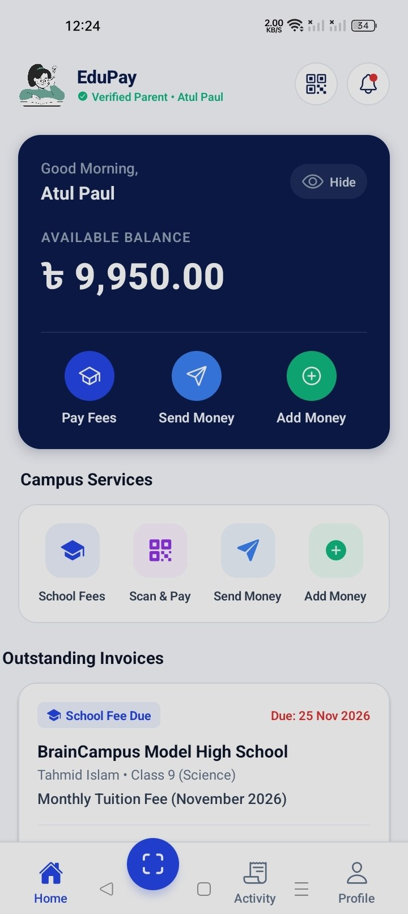

<p align="center">
  
</p>

<h1 align="center">EduPay Financial System</h1>

<p align="center">
  <b>Next-Generation Educational Fintech & Campus Mobile Payment Ecosystem</b><br>
  <i>Combining Bank-Account Linking + MFS Digital Wallet + Campus QR & Automated School Fee Settlement</i>
</p>

<p align="center">
  
  
  
  
</p>

---

## 📌 About EduPay (BrainCampus Pay)

**EduPay** is a security-first, high-performance financial mobile application engineered for educational institutions, parents, students, and campus merchants in Bangladesh (with future interoperable NPSB/Binimoy support).

Instead of forcing users to choose between a pure banking app (PhonePe-style account linking) or a standalone mobile wallet (bKash/Nagad MFS), **EduPay combines both models into a seamless campus financial operating system**:

1. **For Parents & Students:**
   - 1-tap school fee payment with instant digital student invoice fetching.
   - Bank-account linking + stored-value digital campus wallet.
   - Send Money (P2P), Add Money from bank accounts, and digital receipts.
   - Campus QR scanning for canteen, uniform store, and stationery purchases.
2. **For Schools & Academic Campuses (BrainCampus AMS Integration):**
   - Real-time fee collection reconciliation with zero cash leakage.
   - Automated digital receipt generation and student dues tracking.
   - Dedicated merchant settlements for campus vendors and cafeterias.
3. **For Regulatory & Financial Safety:**
   - Designed strictly around **Bangladesh Bank MFS Regulations 2022** and **PSP Guidelines** using an authorized **Partner-Led Escrow Model**.
   - Customer funds are held in regulated partner bank escrow accounts—never commingled with operational SaaS funds.

---

## 📱 Current Mobile UI Preview

Here is the current production interface of the EduPay mobile app running on Android via Expo Go:

<p align="center">
  
</p>

> *The UI features a Deep Navy balance card with privacy eye-toggle, campus quick services, real-time outstanding tuition fee invoice cards, and recent transaction audit records.*

---

## 🚀 Key Features & Capabilities

### 1. Privacy-First Balance Display
- **Deep Navy (`#0B1B4D`) Card:** High-contrast, trustworthy visual identity.
- **Masked Toggle:** Tap-to-reveal balance (`৳ ১২,৪৫০.০০` ↔ `৳ ••••••••`) with native layout animations.
- **Available vs. On-Hold:** Clearly distinguishes freely spendable funds from pending settlement holds.

### 2. Institutional School Fee Engine
- Direct student ID lookup (`BC-2024-089`).
- Displays verified student name, class grade, fee breakdown (Tuition, Sports, Lab), and due dates.
- One-tap payment triggering instant ledger debit and digital receipt emission.

### 3. Multi-Mode Pay & Transfer Hub
- **🎓 School Fees:** Invoice-based fee checkout.
- **📷 Scan QR:** Viewfinder for Bangla QR and campus counter merchants.
- **📲 Send Money:** P2P transfer with quick amount chips (`৳ ৫০০`, `৳ ১,০০০`, `৳ ২,৫০০`, `৳ ৫,০০০`).

### 4. Hardware-Backed Security & Custom PIN Keypad
- **In-App Numeric Keypad:** Built-in custom keypad prevents third-party keyboard keyloggers from capturing sensitive credentials.
- **6-Digit Transaction PIN:** Argon2id server-hashed transaction PIN required for any money movement.
- **Screen Protection (`FLAG_SECURE`):** Prevents unauthorized screenshots or screen recordings on balance and PIN screens.
- **Biometric Step-Up:** Fingerprint / Face ID support via native local authentication.

### 5. Triple-State Financial Assurance
- **`SUCCESS`:** Emerald badge with spring bounce animation, transaction ID, and shareable voucher.
- **`PENDING`:** Amber status explicitly warning users: *"Do not retry. Provider is processing to prevent double debit."*
- **`FAILED`:** Clear error diagnosis with account debit protection.

### 6. Digital Receipts & Audit Trail
- Shareable receipts with verified payment seal, reference number, timestamp, and convenience fee breakdown.
- Searchable transaction history with category filtering (All, School Fees, Sent, Add Money, Merchant QR).

---

## 🛠️ Technology Stack

| Layer | Technology | Purpose |
|---|---|---|
| **Mobile Framework** | **React Native + Expo SDK 54** | Cross-platform Android, iOS, and Web |
| **Routing** | **Expo Router v6** | Type-safe, file-based nested tab navigation |
| **Language** | **TypeScript (Strict Mode)** | Compile-time safety and zero runtime type errors |
| **Icons & Typography** | **`@expo/vector-icons` (Ionicons)** | Crisp, modern vector icon set |
| **Design System** | **EduPay Custom Theme Tokens** | Navy (`#0B1B4D`), Royal Blue (`#2547E8`), Emerald (`#12B886`) |
| **Accounting Core** | **Double-Entry Ledger Architecture** | Immutable journal entries, minor unit poisha (`BIGINT`) |
| **Network & Tunnel** | **`@expo/ngrok`** | Global tunnel access bypassing router AP isolation |

---

## 📂 Project Structure

```text
EduPay-Financial_app/
├── logo.png                          # Official Brand Logo
├── Home_page.png                     # Current UI Visual Reference
├── AGENTS.md                         # Senior Dev & Engineering Rules (Ponytail)
├── mobile/                           # React Native / Expo Application
│   ├── app.json                      # Expo configuration & scheme (edupay)
│   ├── package.json                  # Expo SDK 54 dependencies
│   ├── assets/
│   │   └── images/
│   │       └── logo.png              # App Brand Asset
│   └── src/
│       ├── app/                      # Expo Router File-Based Pages
│       │   ├── _layout.tsx           # 4-Tab Navigation (Home, Pay, Activity, Profile)
│       │   ├── index.tsx             # Home Dashboard with BalanceCard & Invoices
│       │   ├── pay.tsx               # School Fees, QR Scan & Send Money Hub
│       │   ├── activity.tsx          # Filterable Transaction History & Search
│       │   └── profile.tsx           # Security, Linked Bank Accounts & Limits
│       ├── components/               # Reusable Modular UI Components
│       │   ├── BalanceCard.tsx       # Navy Balance Card with Eye Toggle
│       │   ├── SchoolFeeBanner.tsx   # Outstanding Student Invoice Component
│       │   ├── TransactionItem.tsx   # Color-coded Transaction List Item
│       │   ├── PinModal.tsx          # Custom Keypad & 6-Digit Masked PIN Modal
│       │   ├── PaymentResultModal.tsx# Spring-Animated Success/Pending/Failed States
│       │   └── ReceiptModal.tsx      # Verified Payment Digital Voucher
│       ├── constants/
│       │   └── theme.ts              # EduPay Brand Color Tokens & Themes
│       ├── types/
│       │   └── wallet.ts             # Strict Poisha & Financial Transaction Types
│       ├── utils/
│       │   └── currency.ts           # Poisha to BDT (৳) Currency Converter
│       └── data/
│           └── mockData.ts           # Realistic Campus & Financial Mock Data
```

---

## ⚡ Getting Started (Local Development)

### Prerequisites
- Node.js `v20.x` or higher
- npm `v10.x` or higher
- Expo Go on Android / iOS (SDK 54 supported)

### 1. Clone & Navigate
```bash
git clone https://github.com/atul-dev-ai/EduPay-Financial_System.git
cd EduPay-Financial_System/mobile
```

### 2. Install Dependencies
```bash
npm install
```

### 3. Start the Development Server

#### Option A: Run via Tunnel (Recommended for mobile devices on any network)
```bash
npx expo start --tunnel
```
*Scan the generated QR code or copy the `exp://...` URL directly into your phone's **Expo Go** app under "Enter URL".*

#### Option B: Run in Computer Web Browser
```bash
npx expo start --web
```
*Open **http://localhost:8081** directly in your desktop browser.*

---

## 🗺️ Phased Product Roadmap

```
[Phase 1: Campus Payment Gateway & Invoicing] (COMPLETED ✅)
├── UI Design System with EduPay Brand Tokens & Logo
├── School Fee Resolution & One-Tap Checkout Flow
├── Custom In-App PIN Keypad & Masked Security Modals
├── Animated Payment Outcome States & Digital Receipts
└── Verified Compatibility with Expo SDK 54 / Android Expo Go

[Phase 2: Partner-Led Wallet & Core Banking] (IN PROGRESS ⏳)
├── PostgreSQL Immutable Double-Entry Ledger (BIGINT Poisha)
├── Idempotency Key Engine & Transactional Outbox Worker
├── Provider Adapter Interface (Mock -> bKash/Nagad/SSLCOMMERZ/NPSB)
└── Regulated Escrow Account Safeguarding Structure

[Phase 3: Interoperability & Campus Merchant Ecosystem] (UPCOMING 🎯)
├── Bangla QR Merchant Payment Integration
├── Student Canteen & Stationery POS Integration
├── Real-Time Biometric Step-Up & Play Integrity / App Attest
└── Automated BFIU AML / STR Compliance Reporting
```

---

## 📄 License & Attribution

Copyright © 2026 **Atul Paul** / BrainCampus Financial Engineering.  
All rights reserved. Built with precision, security, and a lazy-senior-dev mindset (Ponytail).
